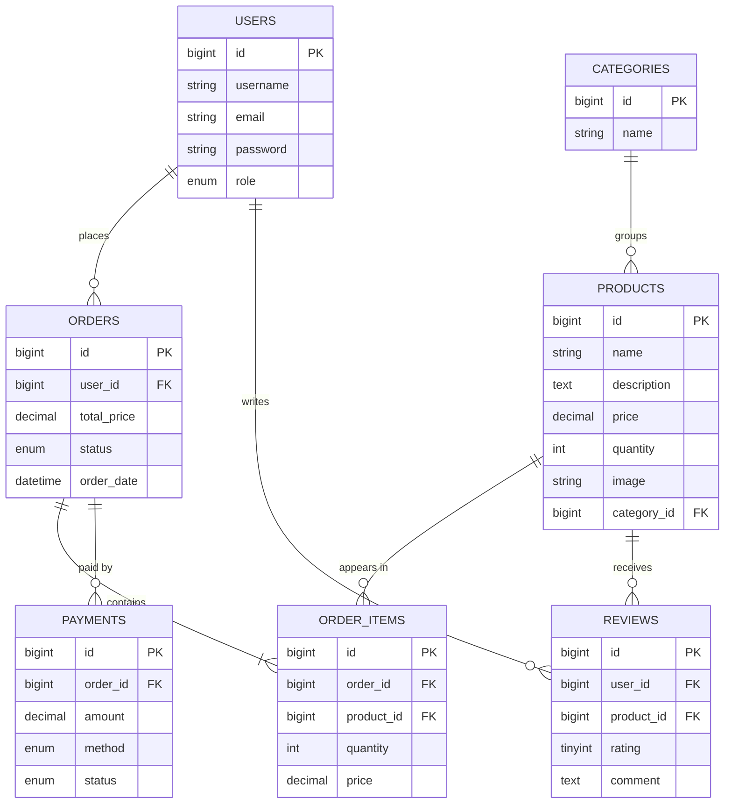

# E-commerce Project Plan (STEP 01)

## 1. Roles and Features

### User
| # | Feature | Notes |
|---|---------|-------|
| 1 | Register | create account |
| 2 | Login | JWT token |
| 3 | View Products | list, pagination |
| 4 | Search Products | by name / category |
| 5 | View Product Details | |
| 6 | Add to Cart | |
| 7 | Update Cart | change quantity, remove |
| 8 | Checkout | |
| 9 | Place Order | |
| 10 | View Orders | order history |
| 11 | View Profile | |
| 12 | Logout | |

### Admin
| # | Feature |
|---|---------|
| 1 | Login |
| 2 | Dashboard |
| 3 | Manage Users |
| 4 | Manage Products |
| 5 | Manage Categories |
| 6 | Manage Orders |
| 7 | Manage Payments |
| 8 | Reports |
| 9 | Logout |

## 2. Technology

| Layer | Technology |
|-------|-----------|
| Frontend | Next.js / React, Tailwind CSS, Axios |
| Backend | Java 21, Spring Boot 3.5.x, Spring Security, JWT, Spring Data JPA |
| Database | Microsoft SQL Server |
| Testing | Postman |
| Tools | IntelliJ IDEA, VS Code, SQL Server Management Studio |

## 3. Database (STEP 02)

SQL script: `database/schema.sql`

## 4. Roadmap Progress

- [x] STEP 01 Project Planning
- [x] STEP 02 Database Design
- [ ] STEP 03 Create Spring Boot Backend
- [ ] STEP 04 Connect MySQL
- [ ] STEP 05 Entities
- [ ] STEP 06 Repository
- [ ] STEP 07 Service Layer
- [ ] STEP 08 REST Controllers / API
- [ ] STEP 09 JWT Authentication
- [ ] STEP 10 Test Backend with Postman
- [ ] STEP 11-18 Frontend, Cart, Orders, Admin
- [ ] STEP 19-21 Validation, Testing, Deployment
